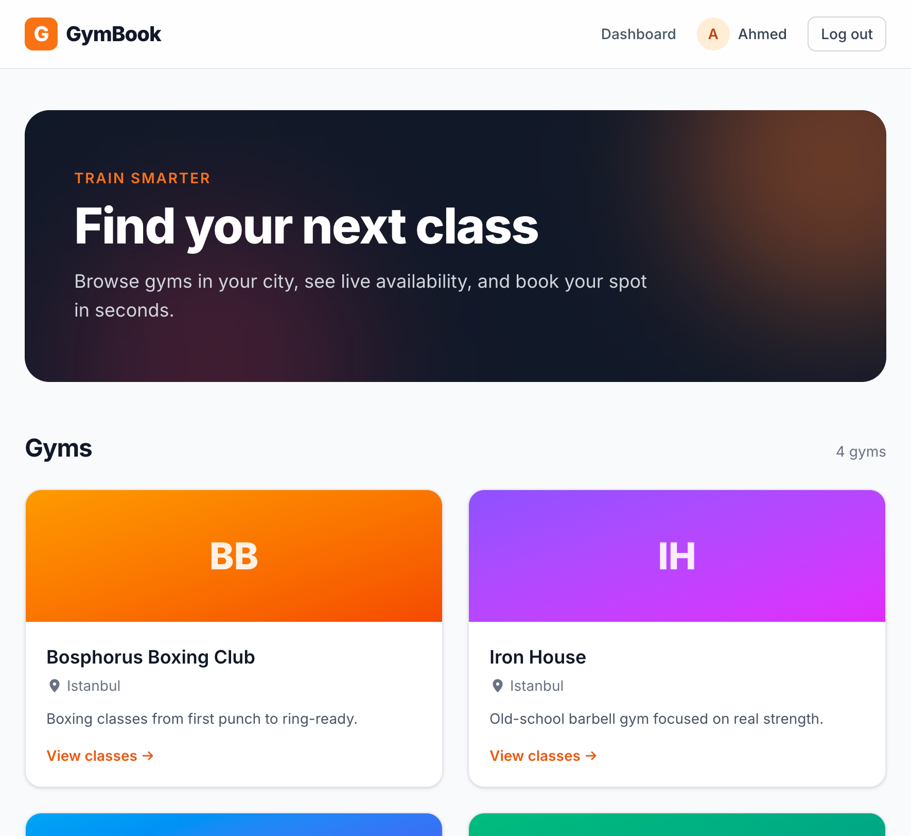
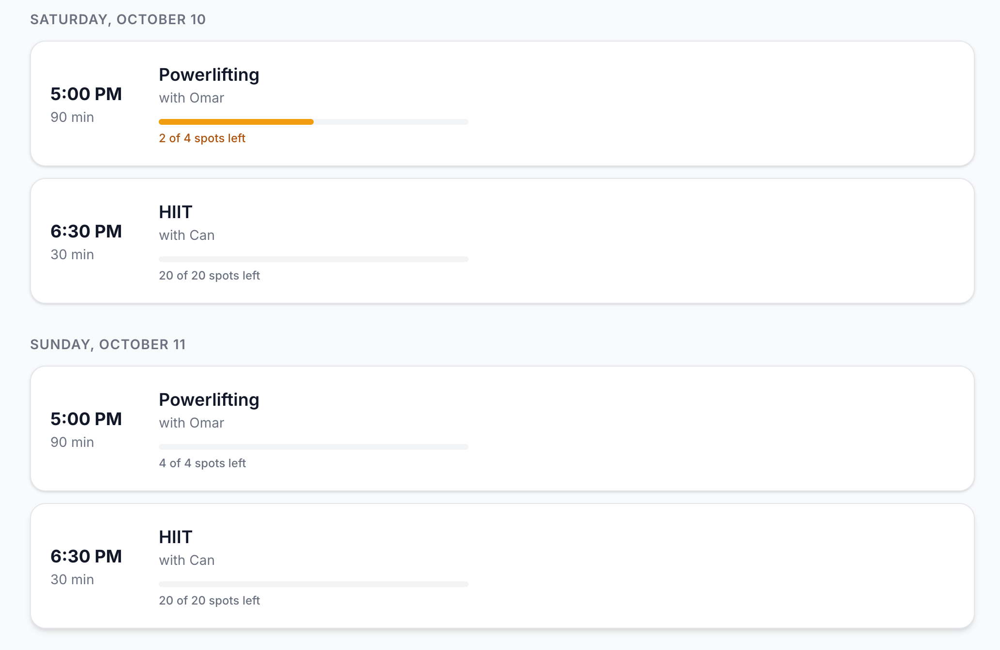

# GymBook

A multi-gym class booking platform. Members browse gyms and book spots in classes; gym owners manage their schedules and see who's coming.

Built with React, TypeScript, Node.js, Express and PostgreSQL.





## Demo accounts

All demo accounts use the password `password123`.

| Role | Email |
|---|---|
| Member | `yousef@test.com` |
| Member | `sara@test.com` |
| Gym owner (Power Fit, Zen Studio) | `owner@test.com` |
| Gym owner (Iron House, Bosphorus Boxing) | `owner2@test.com` |

## Features

**Members**
- Browse gyms and see upcoming classes grouped by day
- Live availability with capacity bars
- Book and cancel classes, view booking history

**Gym owners**
- Create gyms, class types and scheduled sessions
- See the list of attendees for each class

## Technical highlights

### Preventing overbooking under concurrency
Booking runs inside a transaction that locks the session row with `SELECT ... FOR UPDATE` before counting existing bookings.

I verified this with a concurrency test ([`server/scripts/race-test.ts`](server/scripts/race-test.ts)) that sends 10 simultaneous booking requests to a class with 1 spot:

| | Successful bookings | Spots left |
|---|---|---|
| Without row lock | 4 | -3 |
| With `FOR UPDATE` | 1 | 0 |

A partial unique index also prevents a member from holding two active bookings for the same class, while still allowing them to re-book after cancelling.

### Authorization and IDOR protection
Checking the user's role is not enough — every request verifies ownership of the specific resource:
1. The gym in the URL must belong to the current owner.
2. Any class type or session referenced in the request must belong to that same gym.

The second check is what stops an owner from reading another gym's attendee list by combining their own gym's URL with another gym's session ID.

### Other details
- **Time zones:** all times are stored as `timestamptz` in UTC and formatted in the user's local time zone with `Intl.DateTimeFormat`.
- **Data integrity in the database:** `CHECK` constraints (capacity > 0, end after start), foreign keys without cascading deletes so booking history is never lost by accident.
- **Security:** bcrypt password hashing, JWT with a pinned algorithm, parameterized queries throughout, consistent "Invalid email or password" message to avoid user enumeration.
- **Validation:** request bodies validated with Zod on the server; the client mirrors the same limits for instant feedback.
- **Auth state syncs across browser tabs** using the `storage` event.

## Tech stack

| Layer | Tools |
|---|---|
| Frontend | React, TypeScript, Vite, React Router, Tailwind CSS |
| Backend | Node.js, Express, TypeScript, Zod |
| Database | PostgreSQL (`pg`, raw SQL) |
| Auth | JWT, bcrypt |

## Project structure

```
client/          React app
  src/pages/     Route-level pages
  src/context/   Auth state
  src/lib/       API client and shared styles
server/          Express API
  db/schema.sql  Database schema
  src/routes/    API routes
  src/middleware Auth and role checks
  scripts/       Seed data and concurrency test
```

## Running locally

**Requirements:** Node.js 20+, PostgreSQL 16+

```bash
# 1. Database
createdb gym_booking

# 2. Server
cd server
npm install
cp .env.example .env   # then edit DATABASE_URL and JWT_SECRET
npm run seed           # creates tables and demo data
npm run dev            # http://localhost:4000

# 3. Client (in a second terminal)
cd client
npm install
npm run dev            # http://localhost:5173
```

## API overview

| Method | Endpoint | Access |
|---|---|---|
| POST | `/api/auth/register` | Public |
| POST | `/api/auth/login` | Public |
| GET | `/api/auth/me` | Logged in |
| GET | `/api/gyms` | Public |
| GET | `/api/gyms/:slug` | Public |
| GET | `/api/gyms/:slug/sessions` | Public |
| POST | `/api/gyms` | Gym owner |
| POST | `/api/gyms/:slug/class-types` | Owner of this gym |
| POST | `/api/gyms/:slug/sessions` | Owner of this gym |
| GET | `/api/gyms/:slug/sessions/:id/bookings` | Owner of this gym |
| POST | `/api/sessions/:id/bookings` | Member |
| DELETE | `/api/bookings/:id` | Owner of the booking |
| GET | `/api/me/bookings` | Logged in |
| GET | `/api/me/gyms` | Gym owner |

## What I'd improve next

- Move the JWT from `localStorage` to an `httpOnly` cookie to reduce XSS exposure
- Automated tests for the booking and authorization logic, run in CI
- Docker Compose for one-command local setup
- Waitlists when a class is full, and email reminders

---

Built by [Yousef Abouteem](https://github.com/yousef-abouteem)